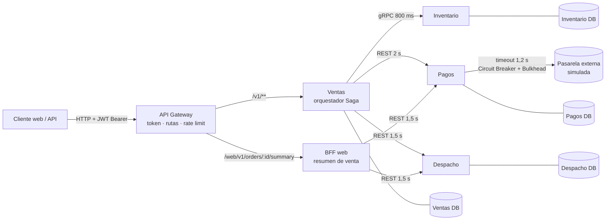

# RepuestosSur

[](https://github.com/ba-hc/tarea-integracion-sistemas/actions/workflows/ci.yml)

Encargo integrador de la **Unidad 3** de **Integración de Sistemas** (Ingeniería Informática,
Universidad de Concepción), **Forma D: tienda de repuestos — vender un repuesto**.

La venta coordina tres servicios de dominio mediante una **Saga orquestada**: reservar stock en
Inventario, cobrar en Pagos (que depende de una pasarela externa frágil) y crear la orden en
Despacho. Si un paso falla, los pasos ya confirmados se compensan en orden inverso. Un **API
Gateway** es el único punto de entrada y un **BFF web** agrega Pagos y Despacho. La llamada a la
pasarela está protegida con **timeout, Circuit Breaker con fallback y Bulkhead**, y el repositorio
trae el script y la evidencia que demuestran que esas protecciones contienen la falla.

- **Informe:** [docs/informe/INFORME-T2.pdf](docs/informe/INFORME-T2.pdf) (fuente en [docs/informe](docs/informe/)).
- **Evidencia de la última corrida de CI:** [docs/evidencia](docs/evidencia/README.md).
- **Video (≤ 8 min):** reconstrucción narrada de esa corrida; **[ver el video (MP4, 5 min 14 s)](https://github.com/ba-hc/tarea-integracion-sistemas/releases/download/t2-video-demo/RepuestosSur-T2-demo.mp4)** (release [`t2-video-demo`](https://github.com/ba-hc/tarea-integracion-sistemas/releases/tag/t2-video-demo)); fuente y cómo regenerarlo en [docs/video](docs/video/README.md). El MP4 no está en git.
- **Guion de demo en vivo:** [docs/t2/DEMO-P4.md](docs/t2/DEMO-P4.md) y el script [scripts/demo/escenarios.mjs](scripts/demo/escenarios.mjs).

## Integrantes y responsabilidades (T2)

| Integrante | GitHub | Etapa | Responsabilidad en la T2 |
|---|---|---|---|
| Tomás Gutiérrez | [`@TomasGutierrez777`](https://github.com/TomasGutierrez777) | P1 | Base T1 y contratos internos, verificación de Inventario, servicio de Despacho con falla inducible (T2-101 a T2-103) |
| Benjamín Henríquez | [`@ba-hc`](https://github.com/ba-hc) | P2 | Pagos y pasarela simulada; timeout, Circuit Breaker y Bulkhead; experimento de carga (T2-201 a T2-203) |
| Martín Fuentealba Bizama | [`@martin777pro`](https://github.com/martin777pro) | P3 | Saga persistente en Ventas, compensación y recuperación, pruebas y ADR-005 (T2-301 a T2-303) |
| Jorge Slimming | [`@JorshSlimming`](https://github.com/JorshSlimming) | P4 | API Gateway y BFF, pruebas integradas, continuidad y guion de demo (T2-401 a T2-403) |

Cada commit lleva el identificador de su tarea (`feat(t2-201): …`). La T1 (Ventas REST +
Inventario gRPC) es la base sobre la que se construyó esta entrega.

## Arquitectura



| Servicio | Rol | Almacén | Expuesto |
|---|---|---|---|
| `api-gateway` | Valida el JWT, enruta, autoriza por rol y limita por cliente | sin estado (contador en memoria) | **Sí: `127.0.0.1:8080`** |
| `web-bff` | Compone en una respuesta el pago y el despacho de una venta | sin estado | No |
| `sales-api` | API de clientes y órdenes; orquesta y persiste la Saga | PostgreSQL `sales` | No |
| `inventory-grpc` | Reserva y libera stock de forma atómica e idempotente | PostgreSQL `inventory` | No |
| `payments-api` | Cobra, consulta y reembolsa de forma idempotente; protege la pasarela | PostgreSQL `payments` | No |
| `dispatch-api` | Crea, consulta y cancela despachos; falla inducible | PostgreSQL `dispatch` | No |
| `payment-gateway-sim` | Pasarela externa simulada: `normal`, `slow`, `down`, `decline` | memoria | No |

Cada servicio de dominio tiene su propia base; ninguno lee la base de otro
([DATA-OWNERSHIP](docs/architecture/DATA-OWNERSHIP.md)). Todas las llamadas entre servicios tienen
límite de espera:

| Llamada | Timeout | Dónde se configura |
|---|---|---|
| Gateway → Ventas | 10 s | `GATEWAY_SALES_TIMEOUT_MS` |
| Gateway → BFF | 2,5 s | `GATEWAY_BFF_TIMEOUT_MS` |
| BFF → Pagos / Despacho | 1,5 s | `BFF_SOURCE_TIMEOUT_MS` |
| Ventas → Inventario (gRPC) | 800 ms | `INVENTORY_RPC_DEADLINE_MS` |
| Ventas → Pagos | 2 s | `PAYMENTS_TIMEOUT_MS` |
| Ventas → Despacho | 1,5 s | `DISPATCH_TIMEOUT_MS` |
| Pagos → pasarela | 1,2 s | `PAYMENTS_GATEWAY_TIMEOUT_MS` |

## Levantar el sistema

Requisitos: Docker con Compose v2.24 o superior. Node.js 24 sólo para el script de escenarios y las
pruebas.

```bash
docker compose up --build
```

Ese único comando levanta los 11 contenedores (7 servicios y 4 bases) con la Saga completa
(`SAGA_STEPS=stock,payment,dispatch`). Sólo el Gateway publica un puerto: `http://127.0.0.1:8080`.
Para esperar a que todo esté sano en segundo plano: `docker compose up --build -d --wait`.

Los secretos del `docker-compose.yml` (API keys internas y `GATEWAY_JWT_SECRET`) son valores de
demo local. Fuera de una máquina de desarrollo, expórtalos o ponlos en `.env` (ver
[`.env.example`](.env.example)).

### Obtener un token

No hay login: el Gateway trae un CLI que firma un JWT de demo de 15 minutos.

```bash
OPERATOR=$(docker compose exec -T api-gateway node dist/src/cli/token.js --sub cajero-1 --role operator)
READER=$(docker compose exec -T api-gateway node dist/src/cli/token.js --sub web-1 --role reader)
```

`reader` sólo puede leer; `operator` puede además crear clientes y vender.

### Vender un repuesto a mano

```bash
GW=http://127.0.0.1:8080
CUSTOMER=$(curl -s -X POST $GW/v1/customers -H "Authorization: Bearer $OPERATOR" \
  -H 'content-type: application/json' -d '{"name":"Ana","email":"ana@example.com"}' | jq -r .id)

curl -s -X POST $GW/v1/orders -H "Authorization: Bearer $OPERATOR" \
  -H 'content-type: application/json' -H "Idempotency-Key: venta-$(date +%s)" \
  -d "{\"customerId\":\"$CUSTOMER\",\"items\":[{\"partId\":\"d6e1fd98-cb07-458f-aa12-6fe220b37604\",\"quantity\":1}]}"

# Resumen del BFF (Pagos + Despacho en una respuesta):
curl -s $GW/web/v1/orders/<orderId>/summary -H "Authorization: Bearer $READER"
```

Repetir el `POST` con la misma `Idempotency-Key` devuelve la misma orden sin volver a cobrar ni
reservar. La API completa está en [OpenAPI](contracts/rest/openapi.yaml).

## Escenarios de falla

El script [`scripts/demo/escenarios.mjs`](scripts/demo/escenarios.mjs) provoca cada escenario a
través del Gateway, muestra qué hace el sistema y deja la evidencia en JSON. Requiere el stack
levantado y Node.js 24. El script deja el stack como lo encontró.

```bash
node scripts/demo/escenarios.mjs exposicion     # Gateway: puertos, 401/403 y rate limit 429
node scripts/demo/escenarios.mjs exito          # 1. Éxito
node scripts/demo/escenarios.mjs compensacion   # 2. Falla del último paso con compensación
node scripts/demo/escenarios.mjs cascada        # 3. Falla en cascada contenida (con y sin protecciones)
node scripts/demo/escenarios.mjs todo           # los cuatro en orden (unos 4-6 minutos)
```

Cada corrida escribe `evidencia/<fecha>/*.json` (ignorado por Git). La CI ejecuta `todo` en cada
PR sobre el `docker compose up` raíz y sube la evidencia como artefacto; la última corrida está
versionada en [docs/evidencia](docs/evidencia/README.md).

### 1. Éxito

`POST /v1/orders` reserva una unidad, la cobra y crea el despacho. El script comprueba la respuesta
`201 CONFIRMED`, el reintento idempotente (misma orden, un solo cobro y una sola reserva), el `409`
con la misma key y otro cuerpo, el resumen del BFF (`CHARGED` + `CREATED`) y la bitácora de la
Saga (`stock → payment → dispatch`, todos `DONE`).

### 2. Falla del último paso: compensación en orden inverso

Despacho se puede configurar para rechazar toda creación antes de guardar nada:

```bash
DISPATCH_FAIL_CREATE=true docker compose up -d --wait --no-deps --force-recreate dispatch-api
# ... vender como arriba: la respuesta es 503 DISPATCH_UNAVAILABLE ...
DISPATCH_FAIL_CREATE=false docker compose up -d --wait --no-deps --force-recreate dispatch-api
```

La Saga reembolsa el cobro y **después** libera el stock. La bitácora queda en la base de Ventas:

```bash
docker compose exec -T sales-db psql -U sales -d sales -c \
  "SELECT step, action, outcome, code, created_at FROM sale_saga_events ORDER BY id DESC LIMIT 6"
```

No queda cobro sin venta (la pasarela registra 1 cobro y 1 reembolso), el stock vuelve a su valor y
no existe una orden pública.

### 3. Falla en cascada contenida (pasarela lenta y caída)

La pasarela simulada cambia de modo en caliente:

```bash
pasarela() {
  docker compose exec -T payment-gateway-sim node -e \
    "fetch('http://127.0.0.1:3010/admin/config',{method:'PUT',headers:{'content-type':'application/json'},body:process.argv[1]}).then(r=>r.text()).then(console.log)" "$1"
}
pasarela '{"mode":"slow","slowDelayMs":3000}'   # lenta: responde a los 3 s
pasarela '{"mode":"down"}'                      # caída: 503 sin aplicar nada
pasarela '{"mode":"normal"}'                    # vuelve a la normalidad
```

Estado del circuito y del bulkhead (no se publica: se lee desde dentro del contenedor):

```bash
docker compose exec -T payments-api node -e \
  "fetch('http://127.0.0.1:3003/internal/v1/resilience').then(r=>r.text()).then(console.log)"
```

Para el brazo **sin protecciones** se recrea Pagos con los patrones apagados:

```bash
PAYMENTS_CIRCUIT_BREAKER_ENABLED=false PAYMENTS_BULKHEAD_ENABLED=false PAYMENTS_GATEWAY_TIMEOUT_MS=30000 \
  docker compose up -d --wait --no-deps --force-recreate payments-api
# volver a los valores por defecto:
docker compose up -d --wait --no-deps --force-recreate payments-api
```

`node scripts/demo/escenarios.mjs cascada` hace todo eso por cada brazo: pone la pasarela lenta y
lanza un pico de 24 ventas simultáneas de 4 clientes, la pone caída y envía 10 ventas seguidas, y
luego la restaura. Mientras tanto mide otras operaciones (`GET /v1/customers` y el resumen del BFF)
para mostrar que el resto del sistema sigue respondiendo. Al final verifica que cada unidad
descontada y cada cobro neto correspondan a una venta confirmada.

El experimento de carga de Pagos (k6, 18 corridas, con y sin protecciones) está en
[experiments/payments](experiments/payments/README.md).

## Requisitos del encargo y dónde se cumplen

| Requisito | Dónde |
|---|---|
| Tres servicios de dominio con almacén propio | `apps/inventory-grpc`, `apps/payments-api`, `apps/dispatch-api` |
| Gateway único punto de entrada; sólo él expuesto | `docker-compose.yml` (sólo `api-gateway` tiene `ports`); verificado en CI |
| Autenticación central con token | JWT HS256 validado en `apps/api-gateway/src/auth` |
| Rate limiting por cliente | `apps/api-gateway/src/rate-limit` (60 peticiones/min por `sub`, `429` + `Retry-After`) |
| BFF que agrega 2+ servicios | `apps/web-bff`: `/web/v1/orders/{id}/summary` = Pagos + Despacho |
| Saga con compensaciones y justificación | `apps/sales-api/src/saga`, [ADR-005](docs/adr/ADR-005-saga-orquestada.md) |
| Idempotencia de pasos y compensaciones | Claves estables por `orderId` en Inventario, Pagos, Despacho y pasarela; `Idempotency-Key` pública |
| Timeout, Circuit Breaker con fallback, Bulkhead | `apps/payments-api/src/resilience`, [ADR-006](docs/adr/ADR-006-resiliencia-pagos.md) |
| Separación de responsabilidades en la exposición | [ADR-007](docs/adr/ADR-007-exposicion-gateway-bff.md) |
| Escenarios reproducibles y evidencia | `scripts/demo/escenarios.mjs`, [docs/evidencia](docs/evidencia/README.md), [experiments/payments](experiments/payments/README.md) |
| Informe | [docs/informe](docs/informe/) |

## Documentación

- Decisiones: [ADR-001 a ADR-004](docs/adr/) (T1), [ADR-005 Saga orquestada](docs/adr/ADR-005-saga-orquestada.md),
  [ADR-006 resiliencia de Pagos](docs/adr/ADR-006-resiliencia-pagos.md),
  [ADR-007 exposición](docs/adr/ADR-007-exposicion-gateway-bff.md).
- Por etapa: [P2 Pagos](docs/t2/P2-PAGOS.md), [P3 Saga](docs/t2/P3-SAGA.md),
  [P4 Gateway y BFF](docs/t2/P4-SPEC.md), [contratos internos](docs/architecture/T2-INTERNAL-CONTRACTS.md).
- Contratos: [OpenAPI v1.1.0](contracts/rest/openapi.yaml), [Inventario gRPC](contracts/grpc/repuestossur/inventory/v1/inventory.proto),
  [changelog](contracts/CHANGELOG.md).

## Pruebas y CI

El workflow [`ci.yml`](.github/workflows/ci.yml) corre en cada PR y push a `main`:

- contratos (Redocly, oasdiff, `buf lint`, `buf breaking`) y validación de los tres archivos Compose,
  incluida la regla «sólo el Gateway publica un puerto»;
- typecheck, pruebas unitarias, integración PostgreSQL y build de Inventario, Ventas y Pagos;
- typecheck, pruebas y build de Gateway, BFF y Despacho, y las pruebas de los runners de `tests/t2`;
- **end-to-end**: `docker compose up` del archivo raíz y `scripts/demo/escenarios.mjs todo`, con
  la evidencia y los logs como artefacto;
- suite black-box y de fallas de dependencia de la T1.

La suite black-box de la T1 (`tests/system`) y el experimento de timeout (`experiments/timeout`)
hablan directo con Ventas, así que usan el overlay de desarrollo, que publica Ventas e Inventario
en loopback:

```bash
COMPOSE_FILE=docker-compose.yml:docker-compose.dev.yml docker compose --profile experiment up --build -d --wait
```

Los runners aislados de P4 (`tests/t2/p4-*.mjs`) siguen funcionando con `docker-compose.p4.yml`
([docs/t2/README.md](docs/t2/README.md)).

## Límites conocidos

- La pasarela es simulada y guarda su estado en memoria; no hay dinero real.
- El rate limit del Gateway y el estado del circuito son por instancia (hay una de cada uno).
- El JWT es de demo (firmado con un secreto local), sin proveedor de identidad ni revocación.
- Las cifras de los experimentos vienen de una sola máquina; no son una prueba de capacidad.

## Uso de asistentes de IA

En la T1 y la T2 se usaron **ChatGPT, OpenAI Codex y Claude Code (Anthropic)** como asistentes
para análisis de arquitectura, revisión de contratos y código, configuración de CI, diseño de
pruebas, redacción de documentación y del informe, y preparación del video de la demo. Las
decisiones, el código y los resultados experimentales fueron revisados por el equipo y
contrastados con las pruebas automatizadas, los ADR y la evidencia de la CI que está en este
repositorio.
